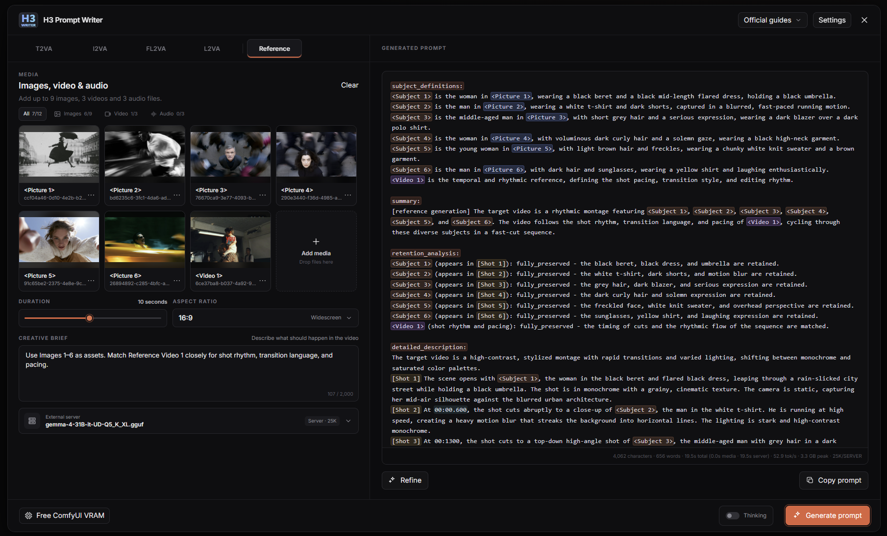

# Usage

## H3 Image

- **Text to Image** writes a standalone prompt from text, photos, or both. With photos alone, Writer describes one image or combines several into a scene.
- **Image Edit** needs a source photo and an instruction. Add the source first and any references after it. Use the same order in the edit workflow. **Refine** can revise an existing prompt without photos.

For photos, select a vision model. Drag cards to reorder them. Picture tags follow their photos. Open **System Prompt** to edit the writing instructions, or **Official guides** to read the [MiniMax prompt-writing skill](https://github.com/MiniMax-AI/MiniMax-H3-Image/blob/40850901ab938303b5274122b5f305ebc5b75c80/skills/h3-image-prompt-writing/SKILL.md).

## Generate a prompt

1. Open the floating **H3 Prompt Writer** button or use **Extensions > H3 Prompt Writer**.
2. Choose a mode.
3. Add the media required by that mode.
4. Set duration and aspect ratio.
5. Describe the intended video in **Creative Brief**.
6. Choose a ready prompt model in **Settings**.
7. Select **Generate prompt**.
8. Review or edit the generated prompt, then select **Copy prompt** and paste it into your H3 workflow.

Generating a prompt does not change or queue your workflow. To add media loaders, use the separate **Media panel** described below.

Use the fullscreen button in the Writer header when you want the workspace to fill the browser. Press Escape to leave fullscreen.

The sun/moon button switches between Dark and Light. The **Aa** button adjusts **Interface Size** from 100% to 125%. These preferences are saved and affect only Prompt Writer, not ComfyUI or exported media.



## Modes

| Mode | Input | How the media is used |
| --- | --- | --- |
| T2VA | Creative Brief only | Writer builds the full audiovisual timeline from text |
| I2VA | One opening image | `<Picture 1>` is the first frame |
| FL2VA | Opening and closing images | `<Picture 1>` is the first frame and `<Picture 2>` is the last frame |
| L2VA | One closing image | `<Picture 1>` is the last frame |
| Reference | Up to 9 images, 3 videos, and 3 audio files; 12 files total | Each active file can provide a specific subject, setting, motion, camera, style, or sound role |

Duration and aspect ratio become part of the request. The generated text remains editable before you copy it.

### Save and load text drafts

Use **Actions > Save text draft** or **Load text draft** to save or open a JSON file for Single H3 or Sequence. Drafts include the brief, prompts, writing instructions, duration and aspect ratio. Sequence also keeps chunk directions, output format and copy formatting. File names include the draft type and local date and time.

Media files, model settings and credentials are not included. Loading replaces the target draft and clears its current media. Reattach the original files and check their labels before generating. File names and Sequence assignments are listed in Technical details as a reminder. This is a text backup, not a complete project archive.

## Sequence

Choose **Sequence** to write several H3 prompts from one Creative Brief. Add chunks and set their durations, from 1 to 15 seconds each. **New chunk duration** applies to the next added chunk. On first use, a short example fills Creative Brief while chunk prompts stay empty. Edit or clear it; saved edits and empty briefs stay as you left them. The sequence keeps its own draft. It does not join videos, connect a workflow, or assume how you will use the chunks.

For a multi-chunk operation, Writer makes one internal semantic planning call to allocate development and intended ending states for the requested chunks. It then makes one generation call per requested chunk, in order. A sequence with only one chunk skips planning. Official output is a full standalone MiniMax H3 prompt, with its own scene description and local `[Shot 1]` numbering. Compact output is a standalone descriptive video prompt in natural language.

The brief and explicit instructions govern intent. Current media and visible prompts, including manual edits, supply scene evidence. The planner reads your original brief, Chunk Direction and objective chunk boundaries. It interprets timing in your own words, without an application-side language parser. The temporary plan distributes events, speech, atmosphere, or sustained activity. It does not require a new action at every boundary or invent a conclusion for an open-ended brief. Each writer continues the actual preceding ending and considers any following accepted opening. Planning is rebuilt for each operation. **Sequence Instructions** lets you adjust shared writing directions. No camera moves or cuts are requested unless you ask for them; added behavior stays modest and consistent with the brief.

### Output format

Open **Sequence Instructions** and choose **Official** or **Compact** below the textarea. Official is the default and follows the full Base/Reference structure. Compact receives its own writing contract, not the official Base/Reference guide. It writes a standalone natural-language description, then two required fields:

```text
A complete description of the scene and action.

overall_soundscape:
Brief, scene-grounded audible sounds.

non_diegetic_music:
N/A
```

Sound stays modest and natural. When you request music, the music field briefly describes it. Without a music request, or when you ask for no music, it stays `N/A`. Useful media literals and local timing remain available.

Both formats share the same brief, media, planner, Chunk Direction, continuity and Generate/Refine behavior. Switching format affects future generations. It does not convert existing prompts or overwrite custom instructions. Restore default resets instructions for the selected format. Compact checks its description, sound fields, media labels and local timing. Missing sound content is not invented by format correction. A format correction cannot rewrite the scene.

### Media and guides

| Assignment | Scope |
| --- | --- |
| First | Opening frame of the first chunk only |
| Last | Closing frame of the last chunk only |
| Reference | Shared references, with additions or exclusions for individual chunks |

In Official format, Writer selects the guide for each chunk's effective media. With references, it uses the official Reference guide. Otherwise it uses the official Base guide: T2VA with no frames, I2VA with First, L2VA with Last, or FL2VA with both. First and Last can also accompany references. Uploading a file does not assign it automatically. The Reference summary starts with an official task prefix. For example, `[keyframe completion + reference generation]` is correct when a frame anchor and an appearance reference are supplied. Keep this prefix.

In the shared brief, use **first frame**, **last frame**, and **reference 1**. In a chunk field, use the tags shown for that chunk. Tags such as `<Picture 1>` are local to each request and can refer to different files in different chunks. The planner reads text and assignment roles; prepared images and video contact sheets go to the chunk writer. Describe audio roles in text, as in Single mode.

### Timing and edits

Chunk ranges show global sequence time. Prompt timestamps start at zero within each chunk. For example, an event at global 25 seconds belongs at local `00:05.000` in a chunk covering 20–30 seconds. Write global event timing in the shared brief and local directions in **Chunk Direction**.

**Chunk Direction** affects that chunk when generated or refined. **Generate sequence** fills empty chunks and retries prompts that need attention. Other prompts stay unchanged. Once all chunks are usable, **Regenerate sequence** rewrites them all. Use a chunk's **Generate** or **Regenerate** to write only that chunk. **Refine** uses its current edited prompt, revision instruction, shared brief, directions, effective media, and existing neighbors. It rewrites only the selected chunk. Editing an earlier chunk does not automatically rewrite later chunks.

### Reading and copying

Edit prompts in place or use **Reader** for a compact view. Official uses Single mode colors for H3 sections, subjects, media tags, shots, timing, and dialogue. Compact highlights `<Picture N>`, `overall_soundscape:` and `non_diegetic_music:`. Highlighting is a reading aid, not a validation result; copied text stays plain. A chunk's copy button copies its prompt. **Copy All** copies nonempty prompts in sequence order. If a chunk needs attention, fix it first; individual Copy remains available. Reader keeps the same attention indicator. **Default** separates them with blank lines. **Custom** applies a chunk template and a separator without changing the saved prompts.

Templates support `{prompt}`, `{index}`, `{start}`, `{end}`, and `{duration}`. Times are global seconds. Try **Divider**, **Time ranges**, **Numbered**, or **Chapters**. The separator field displays escapes such as `\n\n---\n\n` visibly; copying turns `\n`, `\r`, `\t`, and `\\` into their literal characters. This is template formatting, not a regular-expression engine.

### Limits and failures

Planning improves continuity but does not guarantee natural pacing or exact visual fidelity. Some models still stretch a short action across chunks. Review the boundary states, reference tags, and timing before using the prompts. Clear directions help when a brief provides too little action for the requested duration.

A structurally invalid plan stops generation with an error. There is no fallback or hidden semantic repair. Lossless cleanup removes a complete outer Markdown fence and normalizes unambiguous local timestamp typos such as `05:000` to `00:05.000`. A value like `05:00` is normalized only when the chunk duration leaves one plausible in-range time, such as five seconds in a ten-second chunk. It never invents sections, moves events, or rewrites dialogue. Format-specific checks reject incomplete required content, invalid local shots or timestamps, unavailable media labels, and missing required frame anchors. It checks syntax and media contracts, not story quality.

For Official image-only Reference inputs, Writer corrects impossible video/audio task labels from the assigned media roles. This changes only task metadata. Writer allows at most one format correction per chunk with the same writing contract and media. Compact correction can remove stray official headings while preserving description and sound content. It does not change the plan or intentionally rewrite scene content. Ambiguous timing and missing content are left for review.

During generation, chunks show Queued, Generating, Checking, or Repairing. Targeted editors start empty and show each completed prompt immediately. Previous versions stay in Undo/Redo. Cancel stops further work and keeps completed chunks. A failed format check keeps the model output with a small orange attention icon. Hover, focus, or select it for an explanation and a suggested fix. Regenerate, Refine, or edit that prompt directly. Manual edits clear the warning from the previous model output. Runtime and planning errors remain visible until dismissed. Longer prompts, references, and planning context can exceed the model's context limit. See [Sequence troubleshooting](TROUBLESHOOTING.md#sequence-stops-or-repeats-an-action).

## Music 3

Music 3 is a separate workspace for the MiniMax Music 3 model. It writes structured music captions and does not generate H3 video prompts.

Describe the intended sound, vocals, mood, arrangement, and production in **Music Brief**. **Lyrics** is optional. After generation, copy **Generated Caption** to the workflow **Caption** input and pass the original **Lyrics** to the workflow **Lyrics** input.

Use **Refine** under Lyrics to create Lyrics from an empty field or rewrite the current text. Write one instruction for either task. **Use Music Brief** is on by default, so the request can follow the current brief. Turn it off when only the Lyrics and instruction should be sent.

Lyrics change only after a complete response. Cancelling or receiving an error keeps the current text. After a successful request, **Remove generated** returns an empty Lyrics field when the request started empty, while **Restore previous** returns the earlier Lyrics after a rewrite. The instruction stays in the Refine block so you can adjust and reuse it.

Caption Refine uses the current Music Brief, current Lyrics, current caption, and refine instruction. It does not use an older saved copy of the brief or Lyrics.

Music 3 keeps its own saved Music Brief, Lyrics, and edited caption. Open **System prompt** to edit two separate profiles: **Caption** for structured captions and **Lyrics** for creating or rewriting Lyrics. A custom prompt replaces that profile's complete built-in prompt. **Restore default** returns only that profile to its built-in prompt.

## Writing a useful Creative Brief

Write what should happen in ordinary language. You do not need to reproduce the official H3 prompt format. Writer builds that structure for you.

Single and Sequence Creative Briefs have no character limit. The full request must still fit the model context, including guides, media, and room for the answer. Music Briefs keep their separate 2,000-character limit.

A useful brief usually says:

- what happens in the video;
- which reference supplies each important detail;
- what must stay unchanged;
- any exact dialogue, visible text, music, or sound;
- which details from a reference must not transfer.

### T2VA example

T2VA has no media, so describe the scene, action, camera, and sound directly:

```text
A tired baker opens a small street bakery before sunrise. Use one continuous slow push-in as he places the first loaf on the counter and says, "First batch of the morning." Quiet street ambience, wooden shutters and a single doorbell. No background music.
```

### I2VA example

The uploaded image is already the opening frame. Describe what happens next instead of restating every visible detail:

```text
Continue naturally from <Picture 1>. The woman notices a paper boat floating past her feet, follows it along the wet pavement and kneels to pick it up. Keep her appearance, clothes and the evening lighting unchanged. The camera slowly pulls back without a cut.
```

### Reference example

Assign a clear role to each file when several references are active:

```text
Use <Picture 1> for the character's face and hair. Use <Picture 2> only for clothes and <Picture 3> for the rainy tram-stop setting. Use only the slow lateral camera movement and pacing from <Video 1>; do not copy its performer, clothes, background, lighting or audio. The character waits alone, notices an approaching light and turns into the wind. End on a quiet close-up.
```

The roles can be short. Phrases such as `use for appearance`, `clothes only`, `background`, `movement only`, `camera motion only`, and `keep the visible text exactly` are enough when the intent is clear.

Every active picture and video in Reference mode belongs to the request. It does not need to become a main subject, but Writer expects the generated prompt to account for it. Uploaded audio remains available in the manifest without automatically becoming part of the prompt. During Generate, an exact canonical tag in the Creative Brief, such as `<Audio 1>`, makes that audio reference required.

### Audio example

Prompt models do not hear the audio file, so describe what should be taken from it:

```text
Use <Audio 1> as the full soundtrack: slow solo piano with three soft notes followed by a long pause. Use <Audio 2> only as a reference for the narrator's low, breathy voice. Do not copy any words from it.
```

Include a transcript when exact speech or lyrics matter. Writer preserves user-supplied dialogue and visible text rather than asking the prompt model to guess them.

## Images and video

Images are sent to the selected multimodal model in reference order. Reordering Reference media preserves each asset’s assigned tag. A temporarily ineligible asset reserves its tag until it becomes eligible again.

In Reference mode, select **Replace** on an asset card or drop one new file on the card. The new file keeps the same position in the list. It can be a different media type, so check any Picture, Video, or Audio tags in your brief after replacing it. Dropping several files on a card adds them to the end of the list instead.

Single Reference labels follow the current order of ready media within each type. Deleting or reordering media updates the labels and matching tags in the Single Brief, prompt, and Refine text. Same-type replacement keeps its slot. References to removed or unavailable media become tags such as `<Missing Picture 1>`; replace or remove them before Generate or Refine. Sequence keeps its separate chunk-local labels.

For video, Writer prepares an ordered contact sheet. Open a video card to inspect **What the model sees** and choose the available frame-sampling options. The contact sheet still represents the same `<Video N>` reference; it does not create extra `<Picture N>` tags.

Local providers and remote API providers use the prepared contact sheet instead of the original encoded video stream. API providers can receive the derived sheet, but not the original video bytes.

## Media Editor

Open a picture or video card to edit it. Crop pictures, trim or crop video, and inspect the applied result in **What the model sees**. For video, you can also download the current frame or add it as a new Picture.

For a video with audio, select 2-15 seconds and use the **Extract audio** icon next to **Add current frame as Picture**. Writer downloads a WAV file and adds it as an Audio reference, keeping the video unchanged. This uses the current trim selection without requiring Apply. Connect the WAV separately in H3. Writer does not analyze its sound; describe its intended role in the Brief.

Edits stay in the editor until you select **Apply**. **Reset edits** returns the draft to the original media; Apply saves that reset. Closing with unapplied changes lets you keep editing or discard the draft. The original file is preserved.

Long clips can stay in Media with **Trim required**. Trim them to 2–15 seconds and Apply before using them as H3 Reference inputs.

## Media Composer

In Reference mode, open **Actions > Compose** to combine existing pictures and video contact sheets. Use Auto or a column layout, then move and resize items as needed. You can add captions and choose the canvas shape and output size.

**Add as Picture** adds the collage as a new, independent Picture. You can also download or copy the PNG. Later changes to the source media do not update an existing collage.

## Media panel

Open **Media panel** from the Writer header or **Actions > Media panel**. It floats over the workflow without blocking the canvas. Drag its header to move it; the position is saved. Opening Writer temporarily hides the panel, and closing Writer brings it back.

Drag media to empty canvas to create a Load Image, Load Video, or Load Audio node. Drop onto a compatible loader to replace its file without changing its connections. Supported targets are ComfyUI's **Load Image**, **Load Image (as Mask)**, **Load Video**, **Load Audio**, and Video Helper Suite's **Load Video (Upload)**. Other nodes are left unchanged.

Each drop uses the original file or its latest Applied edit. Unapplied drafts and video contact sheets are not transferred. Media marked **Trim required** can still be transferred. Later Writer edits do not update existing loaders; drag again when you want the new version.

Transferred files are stored in `ComfyUI/input/prompt-writer`. Reusing unchanged media reuses the file. If there is no media, Writer shows **Add media first**.

## Audio references

Prompt models do not receive audio bytes. Audio remains a typed `<Audio N>` reference in the request manifest. State its intended role in the brief:

```text
Use <Audio 1> as the full soundtrack.
Use only the rhythm of <Audio 2>; do not copy its voice.
```

Include any transcript, voice description, music style, rhythm, or sound detail that the prompt needs.

Uploading audio alone does not require its tag in the generated prompt. During Generate, only an exact canonical mention such as `<Audio 1>` in the Creative Brief makes that audio reference required. Text without a canonical tag has no structural reference meaning to Writer; the prompt model still interprets its natural-language meaning.

## How Reference mode keeps track of media

Every active picture and video is expected to be accounted for with its exact `<Picture N>` or `<Video N>` tag. Uploaded audio tags are allowed only when they exist in the current manifest. Generate requires the audio tags used in the Creative Brief. Refine preserves audio tags already present in the current prompt unless the revision instruction contains that exact tag.

Use **Insert reference** beside **Refine** to add a current subject, picture, video, or audio tag at the caret in the Creative Brief, Generated Prompt, or Refine instruction.

In Single mode, Writer checks the required format and exact media tags after generation. A valid prompt is returned without being rewritten. If a visual reference tag is missing, Writer can make one correction using the same prepared media. If the correction does not pass the check, Writer keeps the original prompt and shows a warning instead of hiding the problem. Sequence uses its own bounded contract correction and per-chunk attention behavior described above.

## Refine

This section describes Single mode. For chunk revisions, see [Sequence](#sequence).

Select **Refine** to rewrite the current prompt from a short revision instruction. Refine uses the currently selected provider and model. It keeps the current task context and media manifest, and uses the prompt visible in the editor, including manual edits. A normal Refine request does not attach prepared image or video payloads again. After a successful rewrite, you can restore the previous prompt.

In Reference mode, Writer preserves an existing audio reference when its exact `<Audio N>` tag is absent from the revision instruction. When the instruction contains that tag, the reference is mutable for this revision: the prompt model decides from the instruction's meaning whether to add it, keep it, change its role, or remove it. The audit accepts either presence or absence and a format-repair pass preserves that decision instead of restoring the previous reference inventory. The next Refine pass uses the resulting current prompt as its audio-reference baseline; the original Creative Brief does not independently restore a tag removed by an earlier revision.

Any canonical reference tag used by the Creative Brief or revision instruction must exist in the current media manifest. A revised prompt containing a tag outside that manifest is rejected by the audit.

Reference video and audio clips must be 2 to 15 seconds long. An audio-only Reference manifest is not valid; add at least one image or video. Each uploaded file is limited to 1 GB.

## Thinking

For Direct GGUF and compatible Ollama models, the **Thinking** switch asks the model to use a larger reasoning budget. Auto context plans for the assembled input, reasoning, and final answer rather than silently shrinking Thinking to save VRAM.

Direct disables Thinking when a manual context is smaller than 16K. Gemma offers 8K, 16K, and 24K presets. Supported Qwen models offer 16K, 24K, 32K, and 48K presets. Direct also accepts an exact Custom Context. Writer counts Qwen input tokens before loading the full model. In Direct Advanced settings, Generation budget can stay on Auto or use a preset or Custom token limit. Reasoning effort appears only when the selected GGUF template declares supported values. Ollama shows the switch only when the model reports Thinking support. API providers manage reasoning separately. Gemini exposes **Minimal**, **Low**, **Medium**, and **High** in API Settings.

If a model still cannot complete Thinking, Writer reports the fallback. It does not present a standard-mode retry as though the full Thinking request succeeded.

## Saved settings and drafts

Writer saves stable preferences in the browser used to open ComfyUI:

- mode, duration, and aspect ratio;
- selected provider and available model preference;
- Direct Context, KV, Generation budget, and reasoning effort preferences;
- Ollama host and the selected model tag for each host;
- External URL and optional Model ID;
- API preset, URL, model ID, Gemini Thinking level, and Custom capabilities;
- custom Standard, Reference, Music 3 Caption, and Music 3 Lyrics system-prompt overrides.

It never saves API keys. If a saved model no longer exists, discovery falls back without treating the missing model as a fatal error.

Every H3 mode keeps its own Creative Brief and editable prompt draft across a page reload. Music 3 separately keeps its Music Brief, Lyrics, and edited caption. Uploaded media is session content and is not restored after reload.

In **Settings > Prompt behavior**, select **Restore default drafts**. The button changes to **Click again to confirm** for five seconds. Select it again to delete every saved mode draft. The current mode immediately returns to its current built-in Creative Brief and prompt; the other modes use their current built-in defaults when opened. This includes Reference. Media, provider settings, custom system prompts, and API credentials are not changed.

## System prompts

H3 prompt behavior is shared by all providers and has two profiles:

- **Standard** for T2VA, I2VA, FL2VA, and L2VA;
- **Reference** for Reference mode.

Editing a profile creates an override of the built-in H3 instruction. It does not replace the separate official MiniMax guide for the selected mode. Resetting an override returns to the current built-in system prompt; there are no separate Standard system prompts for each mode.

Music 3 has a collapsed **System prompt** control in its workspace. It contains separate **Caption** and **Lyrics** profiles. The collapsed row shows **Custom** when either profile has an override. These prompts apply through the selected provider in the same way as the H3 profiles.

## Lifecycle controls

- **Free ComfyUI VRAM** releases workflow models loaded by ComfyUI while preserving cached node results. It is separate from the prompt model.
- **Unload Ollama** releases an idle Ollama model retained by Writer.
- **Unload Direct** releases an idle Direct GGUF model.
- **Cancel** stops the current Writer request.
- **Stop & unload** cancels an active Direct or Ollama request and forces that prompt model to unload at the next safe point.
- **Prompt models · N** groups unload actions when more than one Writer-managed local prompt model remains resident.

**Keep model loaded** applies to Direct, Ollama, and verified External llama.cpp routers. It is off by default. Single-model External servers and API providers only use **Cancel** because their lifecycle is server-managed.

**Auto VRAM** is an optional ComfyUI-only control for Direct GGUF, local Ollama, and External llama.cpp. Before Writer starts, it asks an idle ComfyUI to unload workflow models and waits for the release to be confirmed. Before ComfyUI Queue continues, it stops and unloads a Writer-managed Direct or local Ollama model and confirms that it is no longer resident. Verified External routers also unload the exact selected model before Queue and confirm its state; single-model External servers receive only the before-generation step. Writer generation does not start if ComfyUI is busy or its release cannot be confirmed. Ordinary ComfyUI Queue is best-effort: cleanup failure or timeout shows a warning but does not block Queue. The control is off by default and is not shown in Standalone.

Provider setup details are in [Choose a provider](PROVIDERS.md). Error-specific steps are in [Troubleshooting](TROUBLESHOOTING.md).

### Desktop notifications

Enable **Desktop notifications** below System Prompt in Settings and allow browser
notifications. Writer notifies you when a request finishes or fails while its tab
is hidden. Sequence sends one notification per run. Cancelled requests stay quiet.
This works in ComfyUI and Standalone where the browser supports notifications.
Keep the page open; browser and system notification settings still apply.
